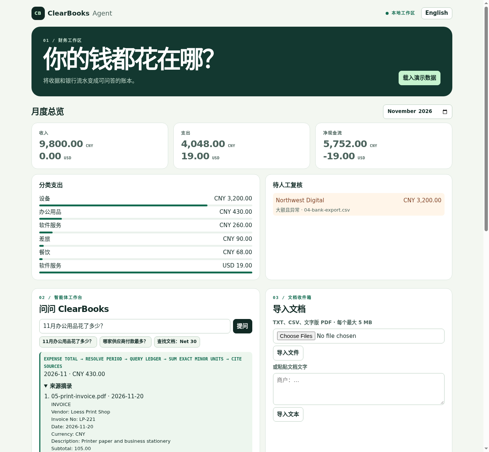

# ClearBooks Agent · 小微财务智能体

ClearBooks Agent — personal/small-business document & finance assistant for **2026 华为开发者大赛·智能体创新赛 · 西北赛区 · OPC 组**. It turns invoices, receipts and bank exports into an auditable local ledger. No paid API key or Huawei Cloud account is required to run the demo.

## Run in two commands

```bash
bash readme/install.sh           # Python 3.10+
cd project && ../.venv/bin/python -m clearbooks serve
```

Open <http://127.0.0.1:8765/>. Click **Load demo data** and select **2026-11**. Use a fresh SQLite database for the demo (see [project instructions](project/README.md)).

1. **Import**: Upload `project/samples/05-print-invoice.pdf` or paste a receipt; compare it with the sample CSV and planted duplicate. Search non-transaction documents with “Find document: Net 30”.
2. **Inspect**: CNY income **9,800.00**, expenses **4,048.00**, net **5,752.00**; USD is separate. The **CNY 3,200.00** equipment charge is both large and atypical by the stated rules.
3. **Ask**: “How much did I spend on office supplies in November?” → **CNY 430.00**, with three citations. “Which vendor did I pay most?” → Northwest Digital for CNY and Design Kit for USD. Switch to 中文 to try “11月办公用品花了多少？”.
4. **Review**: The demo office budget is CNY 350.00. Select **Generate report** to see the CNY 80.00 overrun, or set the office budget to 500.00 and regenerate to see 70.00 remaining.



[Chinese monthly report and budget screenshot](docs/clearbooks-report-zh.png)

The [CLI](project/README.md) supports the same operation set. A local router resolves intent, month, currency and category, dispatches to SQLite-backed tools and returns an answer with the tool trace and source excerpts. An optional environment-configured model can append a note to the deterministic report using only aggregates. No OCR or automatic currency conversion.

## Verification

`bash readme/install.sh --dev` installs the runtime and pytest. From `project/`, run `../.venv/bin/python -m pytest -q`: **29 passed, 0 failed** on Python 3.10.12. The CLI (`demo`, `import` PDF/stdin, `summary`, `ask`, `budget`, `report`) had **7/7 checked flows**. Headless Chrome verified **6/6 browser flows**, including real PDF upload, paste, both duplicate checks, bilingual Q&A, budget update, and the Chinese monthly report.

## Contest and package

- [Official competition page](https://developer.huaweicloud.com/competition/information/1300000353/html1) · [Chinese text extraction](docs/official_rules_extract_zh.txt). Northwest covers 宁夏、甘肃、青海、新疆、陕西. OPC is the solo track: one individual can form a team (including one person + AI).
- Registration and regional upload close **2026-11-24**; refer to the official page for the exact local submission cutoff. The official endpoint returns a raw `2026-11-24 15:59:59` without a timezone; do not interpret that as a local clock time. The rules say one upload per team per day and the latest submission counts. Regional screening Nov 25–27; regional defense Nov 30–Dec 4; six national qualifiers per region announced Dec 5; national finals in December.
- Advertised total ¥500,000 (cash and gifts); national awards: gold ¥100,000 ×1, silver ¥50,000 ×2, bronze ¥20,000 ×3, Best Agent Practice ¥10,000 ×10, single award ¥5,000 ×5, excellence ¥1,000 gift-equivalent ×115.
- Regional rubric: functionality 30, CodeArts depth 25, domain fit/innovation 25, engineering 15, delivery 5. Huawei Cloud CodeArts/码道 must be used as a core AI coding tool during development. The package **does not yet satisfy** this requirement or the video requirement; see [evidence checklist](codearts_proof/README.md) and [2:50 video script](video/README.md).

| Path | Contents |
| --- | --- |
| [ppt/](ppt/) | Chinese-first editable pitch PPTX and PDF |
| [project/](project/) | App, CLI, tests and fictional samples |
| [video/](video/) | Script/storyboard; add a recorded clip or working link |
| [codearts_proof/](codearts_proof/) | Evidence capture checklist; add genuine records |
| [readme/](readme/) | Environment, installation, deployment, open-source and CodeArts notes |

Build a draft package (leave actual contact information out of Git):

```bash
bash scripts/make_submission_zip.sh '队伍名称' '联系方式'
```

Creates `ClearBooks智能体+队伍名称+v1.0+联系方式.zip` with the required five directories and a 200 MB size check. To build the final archive, prepare your reviewed pitch/CodeArts summary, add real evidence and the video file/link directly to the matching folders **in a private local copy**, then rerun with the actual team/contact values. The script does not upload anything. Registration, real-name verification, team setup, CodeArts development and proof, video recording and submission are participant steps.
